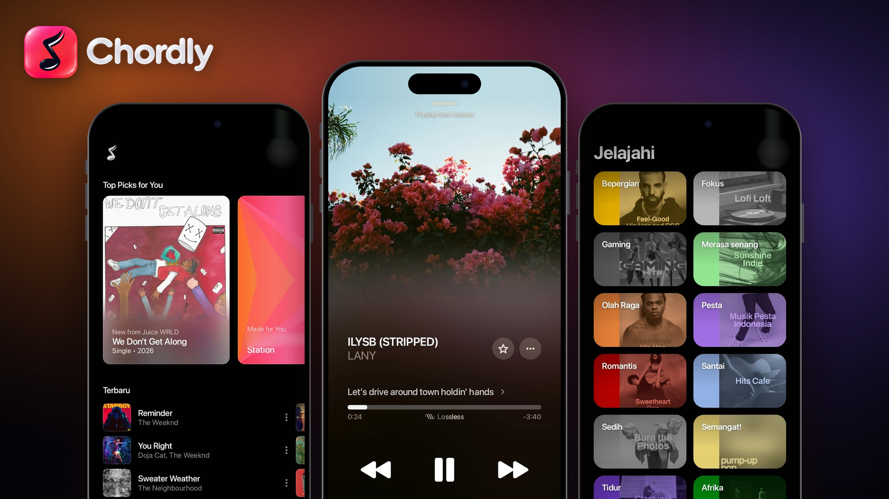

 

### Feel every lyric. Enjoy every note.
**A modern music player for YouTube Music: beautiful to look at, light to use, and made for true listeners.**

 

 

[**⬇️ Download**](#-download) &nbsp;·&nbsp;
[**✨ Features**](#-features) &nbsp;·&nbsp;
[**🎬 Showcase**](#-showcase) &nbsp;·&nbsp;
[**🗺️ Roadmap**](#%EF%B8%8F-roadmap) &nbsp;·&nbsp;
[**❓ FAQ**](#-faq) &nbsp;·&nbsp;
[**🤝 Contributing**](#-contributing)

 

---

## 🎧 About Chordly

**Chordly** is a music player app for **YouTube Music**, designed around one simple belief: listening to music should feel good, not just work.

With an elegant dark interface, **synced lyrics** that appear large and clear, and background colors that adapt to the album art, every song you play feels like it has its own stage.

> Develop with heart by **Callmerev**.

 

## 📡 Platform Status

Chordly is built to live on many screens. Right now the **mobile version is stable and ready to use**, while the other platforms are on their way.

| Platform | Status | Notes |
| :--- | :---: | :--- |
| 📱 **Mobile (Android)** | ✅ **Stable** | Available now, [download the APK](#-download) |
| 📺 **TV** | 🔜 **Coming soon** | Enjoy Chordly on the big screen |
| 🖥️ **Desktop** | 🔜 **Coming soon** | The full experience on your computer |
| ⌚ **Wear OS** | 🔜 **Coming soon** | Control your music from your wrist |

 

## 🎬 Showcase

 

| 🏠 Home | 🎵 Player | 🧭 Explore |
| :---: | :---: | :---: |
| Top picks for you, personal stations, and your latest tracks | Full-screen artwork, complete controls, and a quality indicator | Discover music by mood and genre |

 

## ✨ Features

<table>
<tr>
<td width="50%" valign="top">

### 🎤 Synced Lyrics
Follow every line in real time. The line being sung stands out, while the rest softly fade into the background.

</td>
<td width="50%" valign="top">

### 🎨 Living Colors
The gradient background adapts to the album art, so every song gets its own visual mood.

</td>
</tr>
<tr>
<td width="50%" valign="top">

### 🏠 A Personal Home
Get **Top Picks for You**, **Made for You** stations, and a **Recent** list straight from your YouTube Music account.

</td>
<td width="50%" valign="top">

### 🧭 Explore by Mood
From **Focus** and **Chill** to **Workout**, **Party**, and **Sleep**. Find the right music for any moment.

</td>
</tr>
<tr>
<td width="50%" valign="top">

### 🎚️ A Complete Player
Full-screen artwork, a progress bar, volume control, queue and cast buttons, plus a **Lossless** quality indicator.

</td>
<td width="50%" valign="top">

### ▶️ Smart Mini Player
Keep controlling your music while you browse. The mini player is always ready at the bottom of the screen.

</td>
</tr>
<tr>
<td width="50%" valign="top">

### ⭐ Favorite & Share
Save the songs you love with a single tap and share them with friends anytime.

</td>
<td width="50%" valign="top">

### 🔐 Sign in with Google
Log in with your Google account right from the **Home** page, quick and with no convoluted steps.

</td>
</tr>
<tr>
<td colspan="2" valign="top">

### 📦 One APK for Every Phone
Just one **universal** file. Runs on Android devices with **ARM64, ARM32, and x86_64**.

</td>
</tr>
</table>

 

## ⬇️ Download

Get the latest version from the **Releases** page.

| File | Size | Compatibility |
| :--- | :---: | :--- |
| `app-prod-universal-release.apk` | ~ 186 MB | ARM64 · ARM32 · x86_64 |

 

## 🛠️ Installation

<b>📱 Install on Android</b>

 

1. **Download** the `app-prod-universal-release.apk` file from the [Releases](https://github.com/Callmerev95/Chordly/releases/latest) page.
2. Open **Settings → Security** (or **Apps**), then allow **installation from unknown sources** for the browser or file manager you are using.
3. Open the downloaded APK file, then tap **Install**.
4. Open **Chordly**, then **sign in with your Google account** from the Home page.
5. Enjoy the music! 🎶

**Requirements:**
- An Android device <!-- TODO: fill in the minimum version, e.g. Android 8.0 (API 26) or newer -->
- An internet connection
- A Google / YouTube Music account

 

## ⚠️ Disclaimer

Chordly is an independent project and is **not affiliated with, sponsored by, or endorsed by Google or YouTube**. All music content, trademarks, and copyrights belong to their respective owners. Please use this app in accordance with the YouTube and Google Terms of Service.

